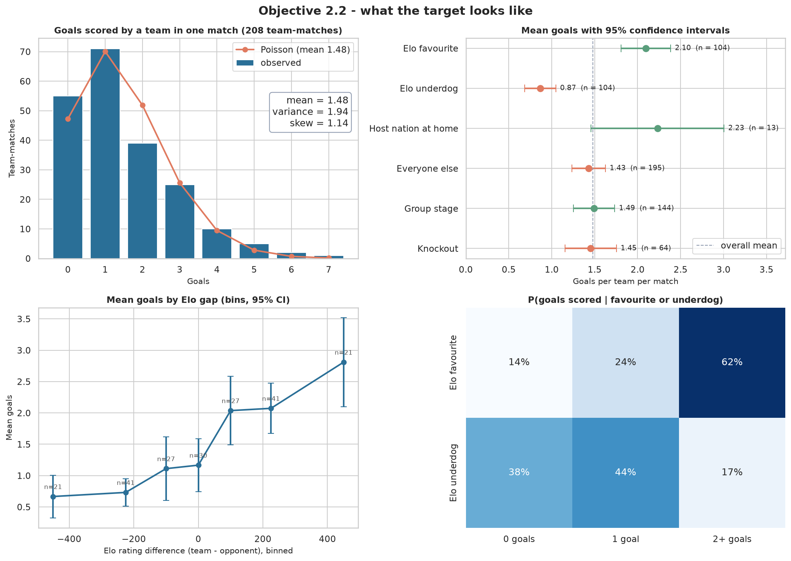
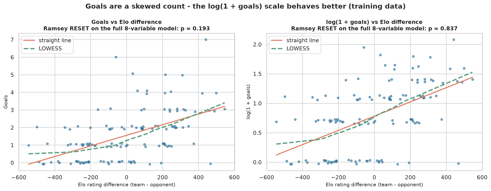
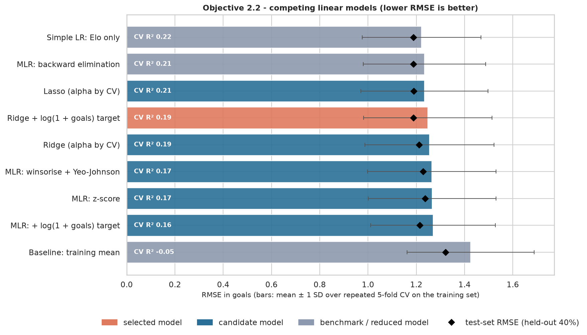
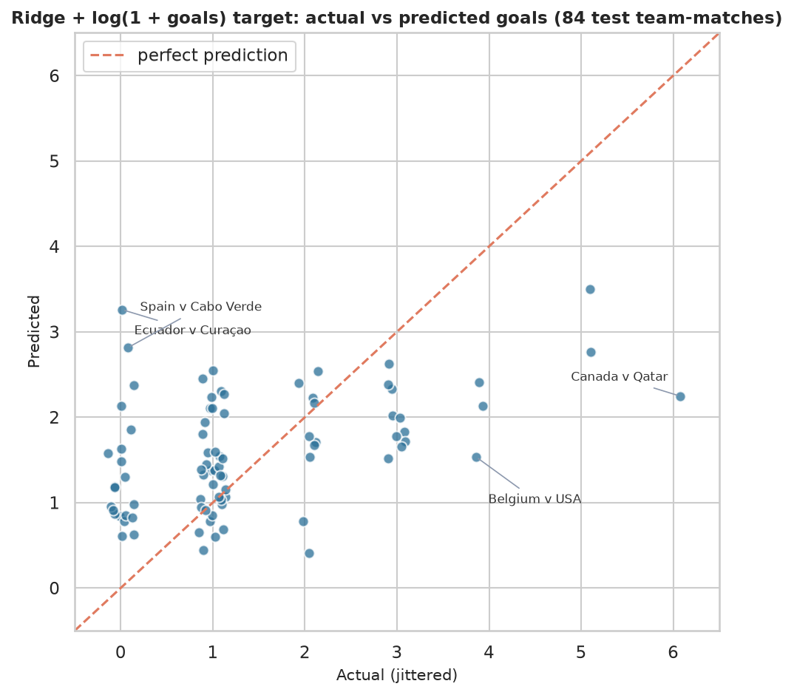
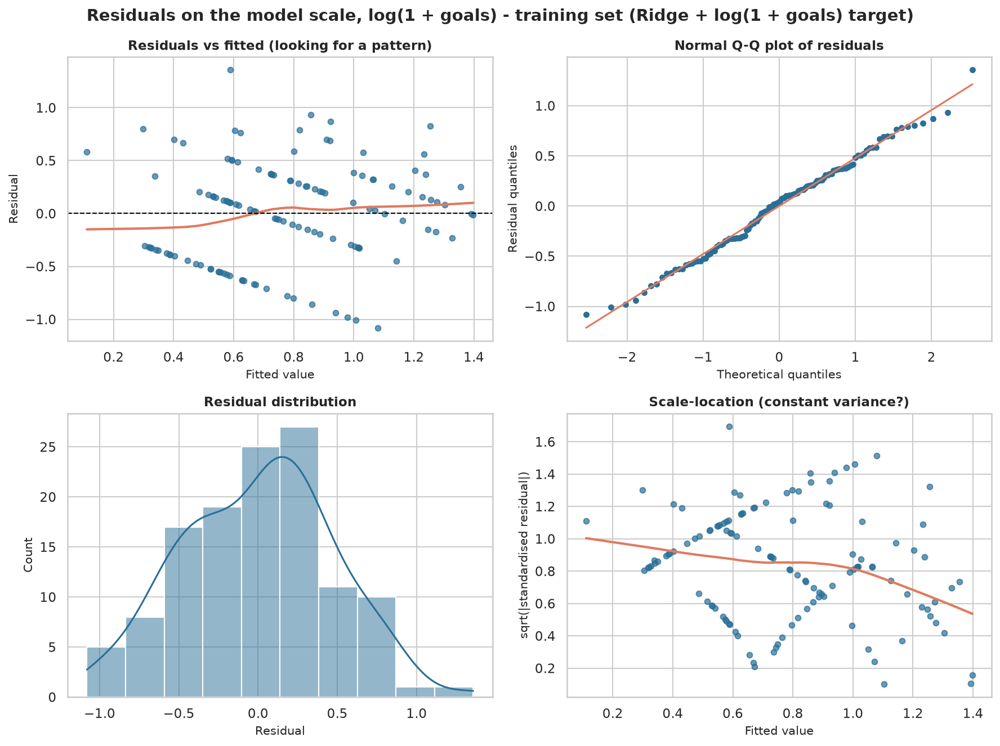
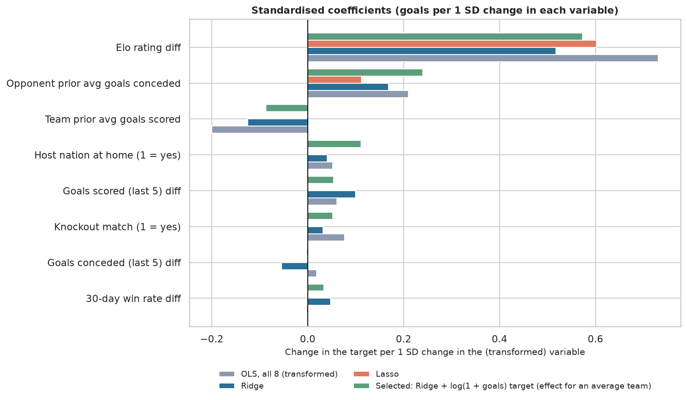
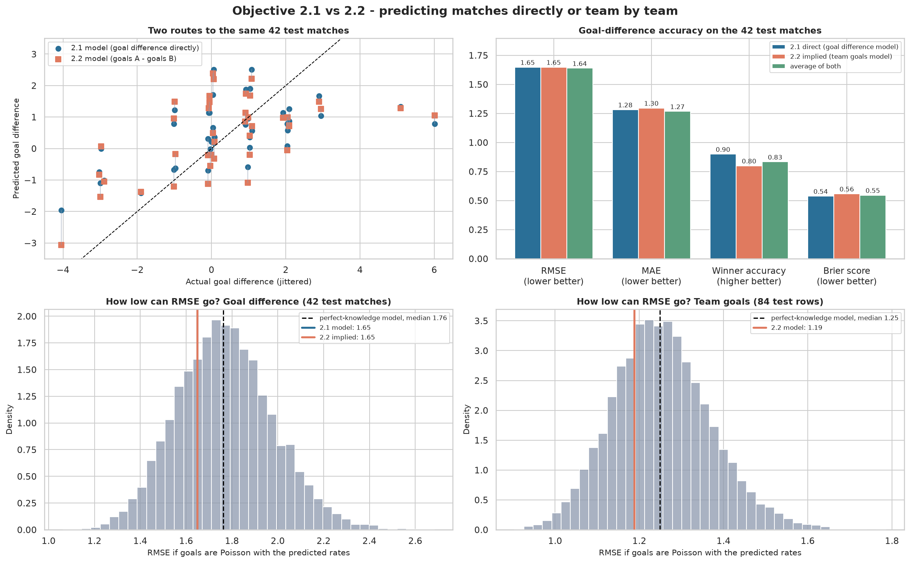

# Objective 2.2 - Predicting how many goals a team scores in a World Cup 2026 match

## In short

Each of the 208 rows is one team in one match. The selected model, **Ridge + log(1 + goals) target**, predicts goals with a test RMSE of
1.188 (baseline 1.321) and R² 0.175 (baseline
-0.021), and 83% of its rounded predictions are within one goal.
Goals are a skewed count, so the model is fitted on log(1 + goals): on that scale every regression assumption holds,
which was not true for raw goals.

## The data

The eight explanatory variables are the Elo, 30-day win rate and last-five goals scored and conceded differences
(team minus opponent, the four variables shared with 2.1), the team's prior average goals scored and the
opponent's prior average goals conceded in this tournament, a knockout flag and a host-nation flag.

The two prior averages start every team at 1.3 goals and add each earlier World Cup match:
(2 × 1.3 + goals in earlier matches) / (2 + earlier matches). This keeps a team's first match from
being undefined and stops one big result from dominating. We rebuilt both variables from the match results and they
agree on all 208 rows, so no variable uses the match it describes.

## What the data shows (weeks 2, 3, 4, 7 and 10)

Teams scored 1.48 goals per match on average (95% CI 1.29 to
1.67), and 74% scored at least once. Elo favourites scored
1.23 more goals than underdogs (p < 0.001), and host nations playing at home
scored 0.80 more than everyone else (p = 0.035, but only 13 such rows). Knockout games
were not lower-scoring (p = 0.839). The variance of goals is 1.31 times the
mean (p = 0.002), so goals are a little more spread out than a pure Poisson count.

Conditional probabilities make the Elo effect concrete: a favourite scored two or more goals
62% of the time and nothing 14% of the time; for an
underdog those figures are 17% and 38%.

## Preparing the data (weeks 8 and 9)

The 60/40 split is done **by match**, so the two rows of a match never end up on different sides (a plain row split
would put both rows of 52 matches on both sides). That gives 124 training rows and
84 test rows, and the test matches are the same 42 as in Objective 2.1.

The two prior averages were the only skewed variables (skewness 0.85
and 1.00); winsorising plus Yeo-Johnson brought both to about 0.
All variables were then on a z-score scale. The largest VIF is 2.83, so collinearity is not a problem.

The real issue was the target. With raw goals the residuals are clearly not normal (Shapiro-Wilk
p < 0.001); with log(1 + goals) they are (Shapiro-Wilk
p = 0.882), and the RESET linearity test improves from
p = 0.193 to p = 0.837.
Predictions are converted back to goals with Duan's smearing factor (1.117); without it the
back-transformed predictions would sit too low on average.

## Competing models

Cross-validation used grouped folds (both rows of a match stay together), 5 folds repeated 20 times.

| Model | CV RMSE | CV R² | Test RMSE | Test R² |
|---|---:|---:|---:|---:|
| Simple LR: Elo only | 1.222 | 0.22 | 1.189 | 0.173 |
| MLR: backward elimination | 1.234 | 0.21 | 1.188 | 0.174 |
| Lasso (alpha by CV) | 1.234 | 0.21 | 1.190 | 0.172 |
| **Ridge + log(1 + goals) target** (selected) | 1.248 | 0.19 | 1.188 | 0.175 |
| Ridge (alpha by CV) | 1.254 | 0.19 | 1.212 | 0.141 |
| MLR: winsorise + Yeo-Johnson | 1.264 | 0.17 | 1.228 | 0.117 |
| MLR: z-score | 1.266 | 0.17 | 1.237 | 0.105 |
| MLR: + log(1 + goals) target | 1.269 | 0.16 | 1.215 | 0.137 |
| Baseline: training mean | 1.425 | -0.05 | 1.321 | -0.021 |

The most accurate candidate in cross-validation was Lasso (alpha by CV) (CV RMSE 1.234), but its residuals fail the normality test (Shapiro-Wilk p < 0.001). **Ridge + log(1 + goals) target** is statistically tied with it (p = 0.569) and passes every assumption test, so it was selected. The Elo-only regression is again statistically tied (p = 0.472).

## The final model on the 84 test rows

| Model | MAE | RMSE | NRMSE | R² |
|---|---:|---:|---:|---:|
| Ridge + log(1 + goals) target | 0.926 | 1.188 | 0.170 | 0.175 |
| Ridge (alpha by CV) | 0.959 | 1.212 | 0.173 | 0.141 |
| MLR: backward elimination | 0.901 | 1.188 | 0.170 | 0.174 |
| Simple LR: Elo only | 0.901 | 1.189 | 0.170 | 0.173 |
| Baseline: training mean | 1.081 | 1.321 | 0.189 | -0.021 |

Bootstrapping whole matches gives a 95% interval of 1.00 to 1.39 for
the test RMSE and -0.17 to 0.37 for R². The rounded prediction is exactly
right 36% of the time and within one goal 83% of
the time. On the log scale the residuals pass every check (Shapiro-Wilk p = 0.882, Breusch-Pagan p = 0.339, Ramsey RESET p = 0.837, Durbin-Watson 1.52); the full statsmodels
summary, including heteroscedasticity-robust (HC3) standard errors, is in `outputs/tables/12_final_model_ols_summary.txt`.
Cook's distance flags 5 training rows, which we inspected and kept.

## Which variables matter

Permutation importance on the test rows ranks the Elo rating, host flag and opponent's prior goals conceded highest for the selected model. The opponent's prior goals conceded has a positive effect: a leaky defence earlier in the tournament means more goals for the next opponent. Over 200 random match splits the mean test R² was 0.190 for
Ridge + log(1 + goals) target and 0.221 for the Elo-only regression, so again a single strong
variable does almost as well as the full model.

## Objective 2.1 vs 2.2 on the same 42 matches

Both objectives hold out exactly the same 42 matches, so we can compare two ways of forecasting a match: predict the
goal difference directly (2.1), or predict each team's goals and subtract (2.2).

| Route | RMSE | MAE | R² | Winner correct | Brier score |
|---|---:|---:|---:|---:|---:|
| 2.1 direct (goal difference model) | 1.648 | 1.283 | 0.313 | 90% | 0.539 |
| 2.2 implied (team goals model) | 1.649 | 1.297 | 0.313 | 80% | 0.559 |
| average of both | 1.639 | 1.268 | 0.321 | 83% | 0.547 |

The two models were built separately, on different datasets, yet they agree closely (RMSE 1.648 vs
1.649), and averaging them gives the lowest error (1.639). The direct 2.1 model is still better at picking winners and its probabilities score better.

How good can a model get here? We simulated scorelines with goals drawn from a Poisson distribution at the predicted
rates (week 11). Even a model that knew every team's true scoring rate would have a median RMSE of
1.25 for team goals (90% range 1.07
to 1.45) and 1.76 for goal
difference. Our models sit at 1.19 and 1.65, inside those ranges. The low R² values are mostly the randomness of football, not missing modelling effort.

## Limitations

Goals are rare, so even 208 rows hold a lot of noise. Host advantage rests on 13 rows. The two prior averages are
weak in the first round because every team starts at the same value. The model predicts expected goals, not exact
scorelines.
