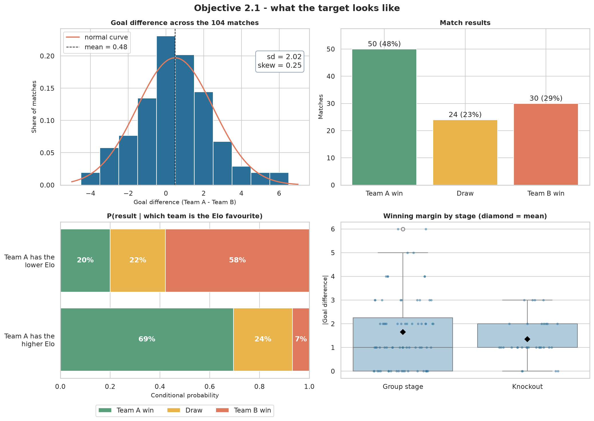
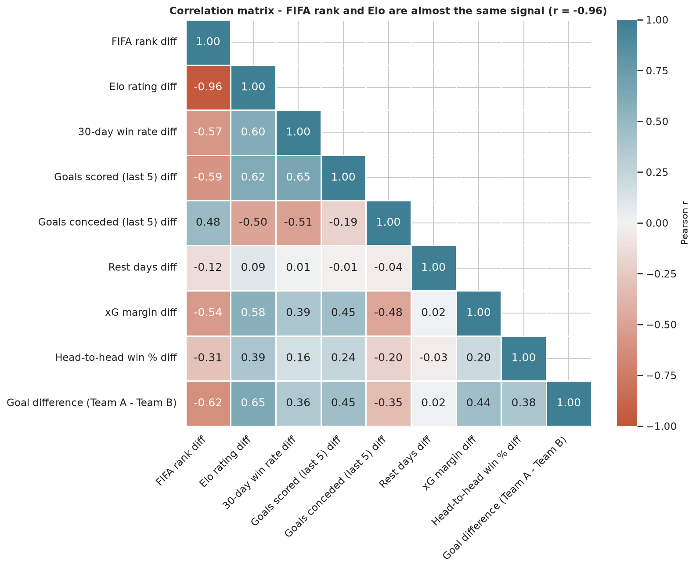
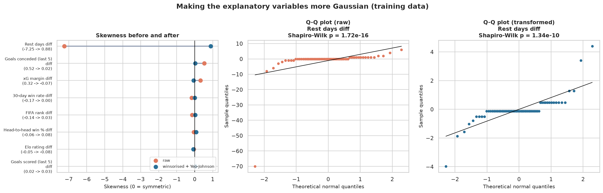
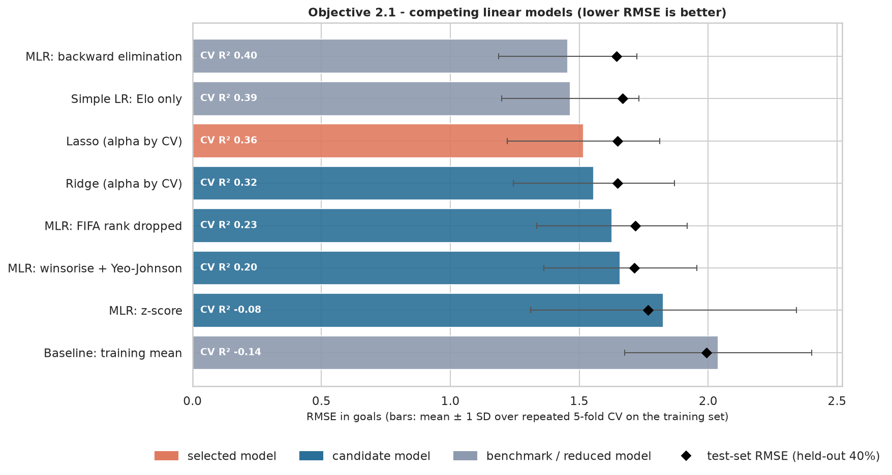
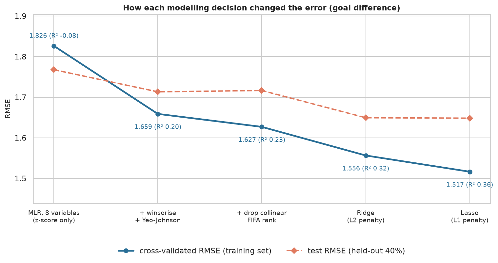
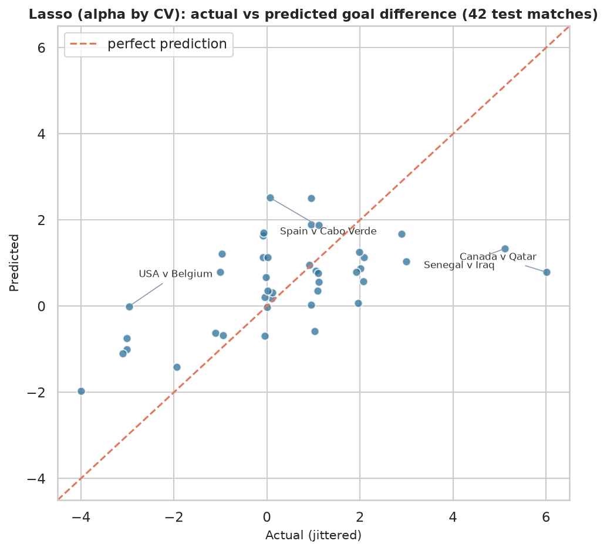
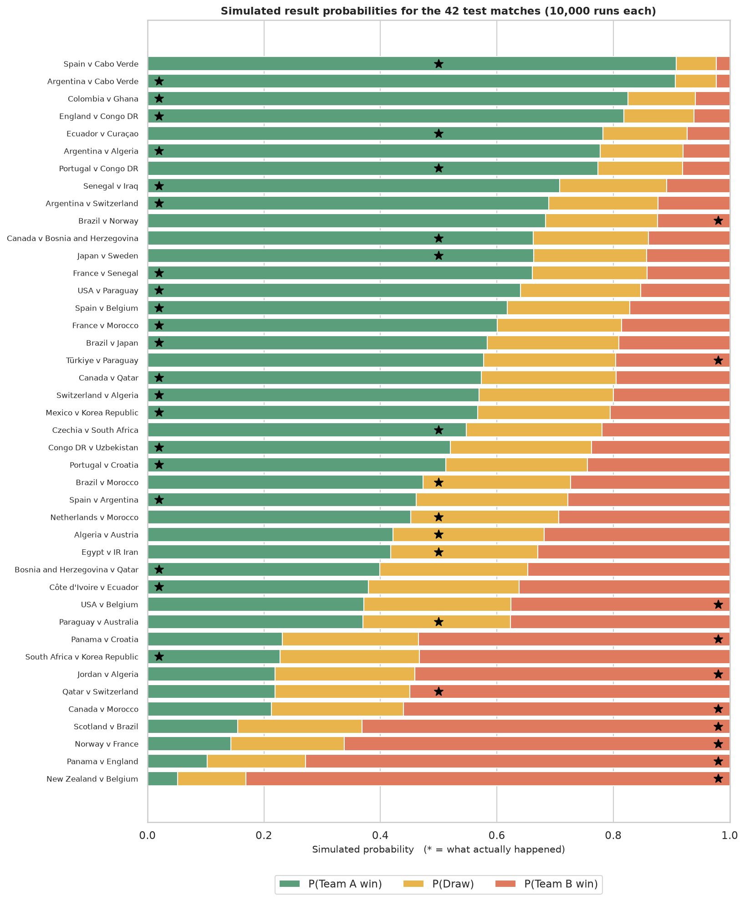
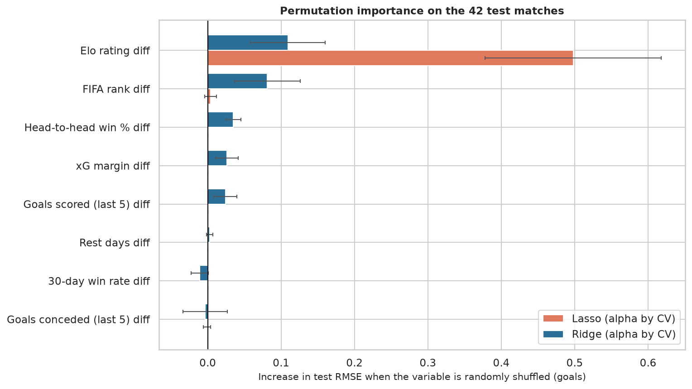
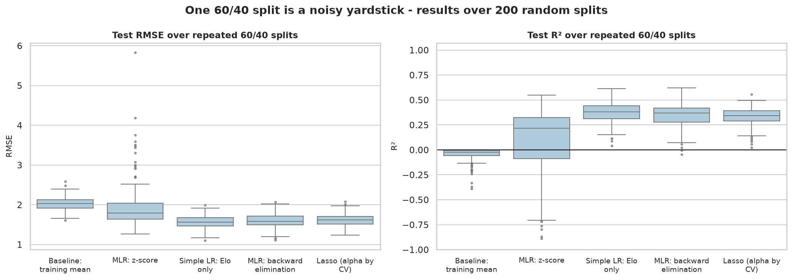

# Objective 2.1 - Predicting the goal difference of World Cup 2026 matches

## In short

We predicted the goal difference (Team A minus Team B) of all 104 World Cup 2026 matches from eight variables known
before kick-off. The selected model, **Lasso (alpha by CV)**, beat the mean baseline on the 42 held-out test matches (RMSE
1.65 vs 1.99 goals, R² 0.313 vs -0.004) and picked the
winner in **27 of 30** test matches that had one. Most of the signal
comes from the Elo rating difference: Lasso keeps only the FIFA rank, Elo rating and goals conceded (last 5) differences, and a one-variable Elo model performs
almost as well.

## The data

Each row is one match. The eight explanatory variables are Team A minus Team B differences in FIFA rank, Elo rating,
30-day win rate, goals scored and conceded over the last five matches, rest days, expected-goal margin and
head-to-head win percentage. None of them uses information from the match itself. The data was compiled from the
FIFA website, The Stats Don't Lie and FBref, and it passes every check in `outputs/data_checks/data_verification.csv`.
The extreme rest-days value of -70 in match 13 is genuine: Uruguay had not played since 31 March, 76 days earlier,
while Saudi Arabia had played six days before.

## What the data shows (weeks 2, 3, 4, 7 and 10)

The average goal difference is 0.48 (95% CI 0.09 to
0.87), and a one-sample t-test says Team A really does better on average (p = 0.009).
That advantage is not about being listed first: once Elo is in the model the intercept drops to
0.19 and is no longer significant (p = 0.235). Team A is simply the stronger
side more often. The team with the higher Elo won 84% of matches that had a winner
(95% CI 76-92%). Knockout games were not
significantly closer than group games (Welch t-test p = 0.098).

Most variables are close to symmetric. Rest days is the exception: almost every value is 0 and Uruguay's 76-day gap
gives a skewness of -7.25 in the training data. FIFA rank and Elo are nearly the same signal
(see the heatmap), and the straight-line vs LOWESS plots show no clear curves; the x² test was significant for
none of them, so no extra non-linear transformation was needed.

## Preparing the variables (weeks 8 and 9)

We followed the week 9 sequence with statsmodels on the 62 training matches:

| Step | Variables | R² | Adj. R² | AIC | Significant at 5% | Max VIF |
|---|---:|---:|---:|---:|---:|---:|
| 1. Raw variables | 8 | 0.513 | 0.440 | 237.1 | 0 | 22.0 |
| 2. Z-score standardised | 8 | 0.513 | 0.440 | 237.1 | 0 | 22.0 |
| 3. Winsorised + Yeo-Johnson | 8 | 0.512 | 0.438 | 237.3 | 0 | 22.6 |
| 4. FIFA rank dropped (collinearity) | 7 | 0.511 | 0.448 | 235.3 | 1 | 3.4 |
| 5. Backward elimination (p < 0.05) | 1 | 0.499 | 0.491 | 224.9 | 1 | 1.0 |

With all eight raw variables no coefficient is significant, because FIFA rank and Elo carry the same information
(VIF 22.0). Z-scoring puts the variables on one scale but does not change the fit.
Winsorising and the Yeo-Johnson power transform pulled the rest-days skewness from -7.25 to
0.88. Dropping FIFA rank brings every VIF under 5 and raises adjusted R², and
backward elimination ends with the Elo rating difference alone.

## Competing models

Every model was cross-validated on the training set (5 folds, repeated 20 times) and scored once on
the test set. The mean predictor, the Elo-only regression and backward elimination are kept as reference models: they
show whether the full eight-variable model is worth it.

| Model | CV RMSE | CV R² | Test RMSE | Test R² |
|---|---:|---:|---:|---:|
| MLR: backward elimination | 1.455 | 0.40 | 1.645 | 0.316 |
| Simple LR: Elo only | 1.465 | 0.39 | 1.669 | 0.296 |
| **Lasso (alpha by CV)** (selected) | 1.517 | 0.36 | 1.648 | 0.313 |
| Ridge (alpha by CV) | 1.556 | 0.32 | 1.649 | 0.312 |
| MLR: FIFA rank dropped | 1.627 | 0.23 | 1.717 | 0.255 |
| MLR: winsorise + Yeo-Johnson | 1.659 | 0.20 | 1.713 | 0.258 |
| MLR: z-score | 1.826 | -0.08 | 1.768 | 0.210 |
| Baseline: training mean | 2.038 | -0.14 | 1.993 | -0.004 |

The rule for choosing the final model was **accuracy first, then validity**: start from the candidate with the lowest
CV RMSE, and among the candidates that are not significantly worse (corrected resampled t-test), take the most accurate
one whose residuals pass every assumption test. That gave **Lasso (alpha by CV)**. Compared with the raw eight-variable
regression its CV RMSE fell from 1.826 to 1.517
(17.0% lower). The Elo-only regression is statistically tied with it
(p = 0.327), which is itself a finding: the other seven variables add little once
Elo is known.

## The final model on the 42 test matches

| Model | MAE | RMSE | NRMSE | R² |
|---|---:|---:|---:|---:|
| Lasso (alpha by CV) | 1.283 | 1.648 | 0.165 | 0.313 |
| MLR: backward elimination | 1.258 | 1.645 | 0.164 | 0.316 |
| Simple LR: Elo only | 1.282 | 1.669 | 0.167 | 0.296 |
| Baseline: training mean | 1.478 | 1.993 | 0.199 | -0.004 |

The bootstrap 95% interval for the test R² is 0.02 to 0.48 and for
the RMSE 1.24 to 2.06: 42 matches is not many, so these are wide.
Turning the predictions into results, the model picked the correct winner in 27 of
30 decisive matches and got 67% of win/draw/loss outcomes
right. We also simulated every test match 10,000 times (week 11) to get win, draw and loss probabilities; their Brier
score was 0.539 against 0.651 for a baseline that always predicts the
training-set result shares.

The residuals of the final model pass every check (Shapiro-Wilk p = 0.578, Breusch-Pagan p = 0.370, Ramsey RESET p = 0.857, Durbin-Watson 1.83). Cook's distance flags
3 training matches as influential; we looked at them and kept them, because they are real
results rather than errors. The biggest misses were blow-outs such as Canada v Qatar
(actual 6, predicted 0.8); pre-match information cannot see
a blow-out like that coming.

## Which variables matter

Elo is the most important variable in every view: the Lasso path, the standardised coefficients and permutation
importance. Ridge spreads the weight between Elo and FIFA rank because they are so correlated, while Lasso keeps
the FIFA rank, Elo rating and goals conceded (last 5) differences.

## How stable is this?

A single 60/40 split is noisy, so we repeated the split 200 times. Mean test R² was
0.331 (SD 0.087) for Lasso (alpha by CV),
0.374 for the Elo-only regression and
-0.036 (SD 0.829) for the raw
eight-variable regression, which falls apart on some splits.

## Limitations

The test set has only 42 matches, so every test number comes with a wide interval. Goals are rare and random: the
Objective 2.2 report estimates that even a model knowing each team's true scoring rate would have an RMSE of roughly
1.7 for goal difference on 42 matches, which is about where this model sits. Line-ups, injuries and red cards are not in
the data. Team A is usually the stronger side, which the intercept test above accounts for.
